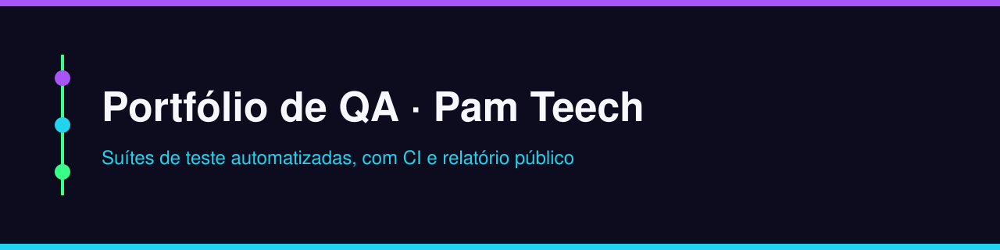

# Portfólio de QA — Pam Teech

Hub das suítes de teste automatizadas da [Pam Teech](https://github.com/pamteech) (Pamella Soares). Cada suíte vive no próprio repositório, com CI e relatório publicado no GitHub Pages.

**Página do portfólio:** https://pamteech.github.io/qa-portfolio/

## Suítes publicadas

| Suíte | O que cobre | Ferramentas | Relatório |
|---|---|---|---|
| [qa-api-cripto](https://github.com/pamteech/qa-api-cripto) | Contrato, sanidade de dados e desempenho de APIs públicas de cripto (CoinGecko, Binance e mempool.space) | Postman, Newman, k6, GitHub Actions | [Relatório](https://pamteech.github.io/qa-api-cripto/) |
| [qa-ledger-speculos](https://github.com/pamteech/qa-ledger-speculos) | Carteira de hardware Ledger Nano S Plus no emulador Speculos: tela, botões, APDU e assinaturas verificadas | Python, pytest, Speculos | [Relatório](https://pamteech.github.io/qa-ledger-speculos/) |

## Em andamento

- Suíte Playwright + Allure do [Treino & Diário Cripto](https://cripto-treino-diario.vercel.app) — há um pull request aberto em [qa-portfolio#1](https://github.com/pamteech/qa-portfolio/pull/1). Ainda não está mesclado.

## Como navegar

1. Comece por este repositório para ter o mapa das suítes.
2. Abra o repositório da suíte para ver o README, a CI e como rodar os testes localmente.
3. Abra o relatório no GitHub Pages para ver a execução mais recente.

## Licença

MIT. Copyright (c) 2026 Pamella Soares (Pam Teech). Veja [LICENSE](./LICENSE).
